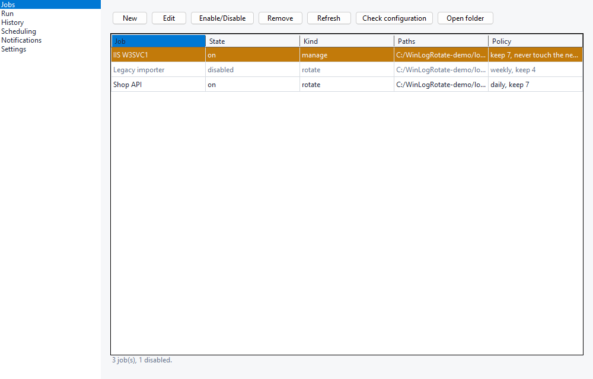
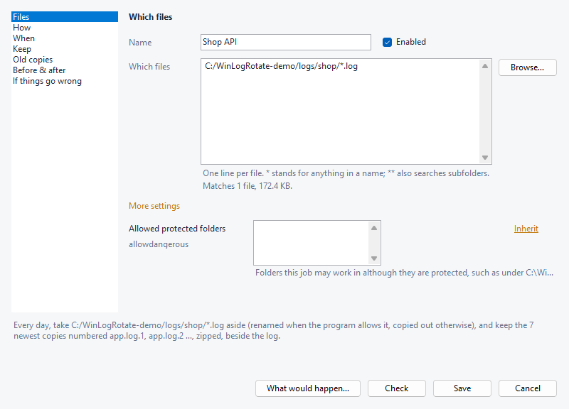
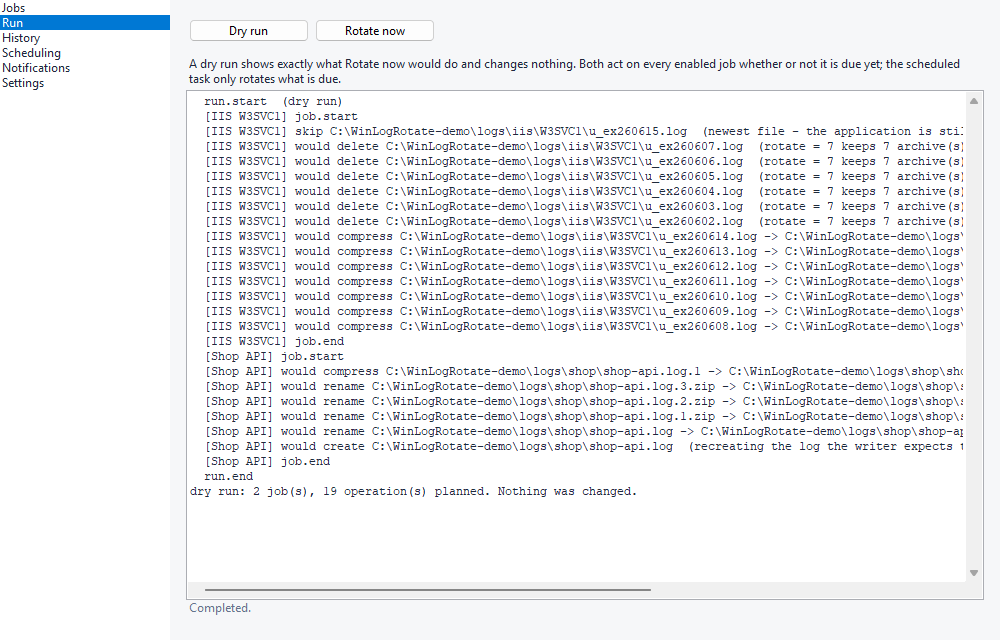
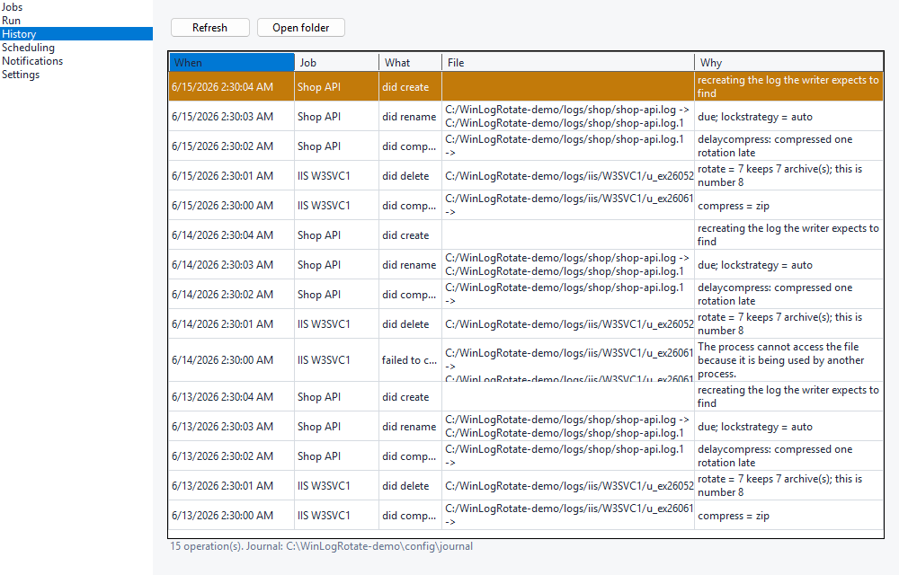

# WinLogRotate

Log rotation for Windows — a CLI, a GUI and a scheduler, imitating Linux `logrotate`'s
*behaviour* on a platform whose filesystem works nothing like Unix's.

Same directive names, so `delaycompress` still means what the man page says. Different
container, because a config a GUI edits has to survive being rewritten.

> **Not related to LogRotateWin.** This is a new MIT-licensed project on .NET 10. The 2013
> SourceForge *LogRotateWin* and its forks are GPLv3 and unmaintained.



**Status:** v0.21.x, pre-1.0. The installer and the scheduler are verified end to end on Windows;
rotation is verified only against files nothing holds open. What has and has not run:
[Status, honestly](#status-honestly).

---

## Why another one

Every existing Windows port is GPLv3, one-shot-only, and leaves scheduling to you. None of
them handle the two things that actually go wrong.

**Files you cannot rename.** Renaming needs `DELETE` access, which every open handle must have
permitted via `FILE_SHARE_DELETE`. IIS, http.sys, SQL Server and most C++ services don't.
log4net's default `ExclusiveLock` denies write sharing too — so *nothing outside the process
can rotate that file*, by any means. WinLogRotate tells you that, instead of failing at 3am:

```
> winlogrotate probe C:\logs\app.log
  verdict     Copy
  This file can only be read, so a copy can be archived but the original will keep growing.

  strategy        supported
  rename          no
  copytruncate    no
  copy            yes
```

**`copytruncate` silently destroying your disk.** A writer that caches its own file offset
doesn't seek back to zero after truncation — its next write lands at the old offset and NTFS
zero-fills the gap. You get four gigabytes of NUL bytes plus one line of log, every rotation,
for ever, without a single error.

WinLogRotate detects it and permanently refuses `copytruncate` for that path
([how](docs/logrotate-compatibility.md#locked-files)).

### And the thing that actually fills Windows disks

It isn't rotation. **IIS, http.sys, NSSM, WinSW, Apache `rotatelogs`, Serilog, NLog, log4net
and Tomcat all roll their own logs perfectly well — and then never delete or compress any of
them.** Disks fill with correctly-rotated files.

So that's a first-class job kind:

```toml
[job]
name  = "IIS W3SVC1"
kind  = "manage"        # IIS rotates; we compress + retain, and never touch the live file
paths = ["C:/inetpub/logs/LogFiles/W3SVC1/u_ex*.log"]
compress = true
rotate   = 30
maxage   = 90
```

No locking, no truncation, no risk. IIS has no way to reopen a log — `appcmd` site stop/start
does *not* release the W3SVC handle, only `iisreset` does — so the live file is untouchable by
anything except IIS, and this mode never tries.

`winlogrotate scan` finds these for you and reports the column that matters:

```
IIS - Default Web Site
  C:\inetpub\logs\LogFiles\W3SVC1
  412 file(s), 2.9 GB
  rotates itself: yes    deletes old ones: NO
```

---

## Install

Two executables, and the split is deliberate. `winlogrotate.exe` is NativeAOT with **no
dependencies at all** — it's what the scheduler runs unattended as SYSTEM on a freshly-imaged
server. Only the GUI needs the .NET runtime, and only in the `-min` builds.

| Installer | Size | Needs anything installed? |
| --- | ---: | --- |
| [`WinLogRotate-Setup-<version>-min.exe`](../../releases/latest) | 4.4 MB | Only for the GUI — the [.NET 10 Desktop Runtime](https://dotnet.microsoft.com/download/dotnet/10.0), fetched for you if missing |
| [`WinLogRotate-Setup-<version>-full.exe`](../../releases/latest) | 45.0 MB | **No** — everything is inside |
| [`WinLogRotate-Setup-<version>.exe`](../../releases/latest) | 45.0 MB | Asks which of the two to install |

| Portable | Size | Needs anything installed? |
| --- | ---: | --- |
| [`WinLogRotate-<version>-min.zip`](../../releases/latest) | 5.8 MB | Only for the GUI |
| [`WinLogRotate-<version>.zip`](../../releases/latest) | 47.3 MB | **No** |

Inside the `-min` zip: `winlogrotate.exe` (12.8 MB, native, zero dependencies) and
`winlogrotate-gui.exe` (1.5 MB). `SHA256SUMS.txt` covers every download.

Updating later is `winlogrotate update apply`, or **Settings → Updates** in the console: the
newer installer is downloaded, checked against the release's `SHA256SUMS.txt`, and run over the
old one; it waits for any rotation in progress and keeps your configuration. Checking is manual
unless you ask for once a day. See [updating](docs/updating.md).

Sizes are v0.21.5's release assets; CI writes the measured binary size to every run's summary.

Installing per-machine:
- puts config in `C:\ProgramData\WinLogRotate\`;
- registers a scheduled task that runs as SYSTEM;
- **locks that directory down to SYSTEM and Administrators**. That is not optional: the task runs
  as SYSTEM and jobs can carry hooks, so a world-writable config directory would let any local
  user run a command as SYSTEM.

Silent install, for deploying to customer sites:

```
WinLogRotate-Setup-<version>.exe /S /AllUsers /HOST=task /CONFIG=\\srv\deploy\jobs
```

Every switch the installer understands:

| Switch | |
| --- | --- |
| `/S` | Silent. Every prompt takes its safe default: an upgrade waits for a running rotation, an uninstall keeps your data |
| `/AllUsers` / `/CurrentUser` | Per-machine (`ProgramData`, SYSTEM task, locked-down directory) or per-user (your profile, no task, hooks refused) |
| `/HOST=task` / `/HOST=none` | Register the scheduled task, or nothing. Anything else is refused before anything is installed |
| `/CONFIG=<dir>` | Copy every `*.toml` from that directory into `conf.d` — a seeded configuration for a fleet |
| `/NOPATH` | Leave PATH alone |
| `/NORUNTIME` | Do not offer to install the .NET Desktop Runtime the GUI needs; the CLI works without it |
| `/FORCEIDLE` | After two minutes of waiting for a rotation in progress, go ahead anyway. Off by default because the process being replaced may be mid-file on a multi-gigabyte log |
| `/RESTART` | Start the console again once the files are in place, as the desktop user rather than elevated. What an in-app update passes |
| `/D=<dir>` | Install directory (the standard NSIS switch; must be last) |
| `uninstall.exe /S /PURGEDATA` | Remove the configuration, state and history too. Without it a silent uninstall keeps them — which is what an in-place upgrade depends on |

The task fires at 03:00 unless `config.toml` says otherwise. For a fleet, follow the install with
`winlogrotate host use task --at 22:30`: `/CONFIG=` seeds job files, not `config.toml`.

---

## Use

```
winlogrotate job add iis --paths "C:/inetpub/logs/**/*.log" --set rotate=14
winlogrotate scan                     # what on this machine needs help?
winlogrotate glob "C:/logs/**/*.log"  # what would this pattern match?
winlogrotate probe C:\logs\app.log    # can this file even be rotated?
winlogrotate config check             # problems, with file, line and column
winlogrotate run --dry-run            # exactly what would happen. changes nothing
winlogrotate doctor                   # paths, permissions, schedule — in one place
```

Or open the GUI, `winlogrotate-gui.exe`: Jobs, Run, History, Scheduling, Notifications and
Settings pages over the same CLI.
- **First start**: with no jobs it says what a job is and offers to add one.
- **The job form** is a menu of sections — Files, How, When, Keep, Old copies, Before & after,
  If things go wrong.
  - Each shows its plain choices first and every other setting under **More settings**,
    captioned in plain words with its default and where its value comes from.
- **How the log is taken away from the program**:
  - let WinLogRotate check what the program allows;
  - copy it out and empty it in place, for a program that keeps it open;
  - rename it;
  - or only tidy up after a program that writes new files itself.
- **The rest of the plain choices**: how often, how many copies to keep and for how long, how
  they are named and compressed and where they go — and one sentence restates what will happen.
- **"What would happen…"** shows a saved job's moves without making them.
- **Rotate now** on the Run page rotates every enabled job whether or not it is due yet, like
  `logrotate -f`.
  - The scheduled task only rotates what is due, and a log it sees for the first time is only
    given a clock.







Every page and dialog, with what each is for: [screenshots](docs/screenshots/README.md).

`--dry-run` is the same code path as a real run, stopped one step earlier — not a separate
description that can drift from what the executor does. `job set --dry-run` works the same way:
validate and save differ by that one flag, so a form cannot show a green tick through one route
and then fail through another.

Everything speaks `--json` for scripting — one envelope on stdout, a stable diagnostic code on
every finding, and five exit codes that mean five different things. See
[automation](docs/automation.md). Every verb the GUI offers exists here too, because WinForms
doesn't run on Server Core and that's where IIS usually lives.

<details>
<summary>Full command surface</summary>

| Verb | |
| --- | --- |
| `run` | Rotate everything that is due |
| `probe <path>` | Which locked-file strategies a path actually supports |
| `glob <pattern>` | Resolve a pattern, or explain why it was refused |
| `config check` / `show` | Validate; print with every default resolved |
| `job add <name>` | Create a job, without writing TOML by hand |
| `job set <name>` | Change keys in place — comments and every other key survive |
| `job enable` / `disable` | Switch a job off and back on, reversibly |
| `job remove <name>` | Delete a job and its file |
| `job show <name>` | Print a job as its file writes it — what to feed back into `job set` |
| `host use task\|none` | Choose what runs rotations — switch freely, any time. `--at HH:mm` says when the task fires |
| `host status` / `repair` / `pause` | Reality vs config; re-apply permissions; suspend |
| `host export-task` | Scheduled Task XML, for GPO or DSC |
| `host path-add` / `path-remove` | Put the install directory on PATH, or take it off — what the installer calls |
| `import <path>` | Convert a Linux `logrotate.conf` |
| `scan` | Find producers that roll but never delete |
| `journal` | Everything compressed, moved or deleted, and why |
| `doctor` | Every path, permission and schedule at once |
| `notify show` / `status` | What is configured to report failures, and what it last decided |
| `notify test` / `reset` | Send a real test message; clear a suppressed channel |
| `notify set-secret` | Store a provider's credential and point the config at it, in one step |
| `secret set` / `list` / `remove` / `test` | The encrypted credential store |
| `secret import` | Several secrets from `name=value` lines, for unattended rollout |
| `update check` / `apply` | Whether a newer release exists; download it, verify it, and run its installer |
| `--version` | The build you are running, for a bug report |

</details>

---

## Configuration

`C:\ProgramData\WinLogRotate\config.toml` holds defaults; one file per job in `conf.d\`.
Every `[job]` key, with its type and default, is in
[configuration](docs/configuration.md).

```toml
# conf.d\myapp.toml
schema = 1

[job]
name  = "MyApp"
kind  = "rotate"
paths = ["D:/apps/myapp/logs/*.log"]

daily         = true
rotate        = 14
compress      = true
delaycompress = true          # logrotate's own word, for the same reason
dateext       = true
missingok     = true
notifempty    = true
lockstrategy  = "copytruncate"

postrotate = ["service:paramchange:MyAppSvc"]
```

- **TOML, and specifically Tomlyn's syntax tree, for one reason: the GUI can change one value
  without touching anything else.** Load-then-save is byte-identical.
  - Load-change-one-value-save differs in exactly one line, and a test opens a hand-written file
    (comment, unknown key, `allowdangerous` entry, CRLF), changes one key and asserts exactly that.
  - Your comments survive — including the "do NOT enable compress, the shipper can't read .gz"
    note. YAML and JSON both destroy comments on write.
- **Inherited stays inherited**: a field the editor shows as inherited stays so unless you type
  in it, so pressing Save never cuts a job off from `[defaults]`
  ([editing a job](docs/configuration.md#editing-a-job-without-opening-it)).
- **`lockstrategy = "auto"`** asks the file what its writer permits and picks accordingly
  ([locked files](docs/logrotate-compatibility.md#locked-files)):
  - rename if it allows `FILE_SHARE_DELETE`, copytruncate if it allows writing, a copy if it
    allows only reading;
  - nothing at all if it allows none of those, which is what log4net's default `ExclusiveLock`
    looks like;
  - `copytruncate` is watched: a NUL run where the truncation left the file refuses the strategy
    for that path from then on.
- **Hooks** replace `kill -HUP`, which Windows doesn't have ([hooks](docs/hooks.md)):
  - `service:paramchange:NAME` sends `SERVICE_CONTROL_PARAMCHANGE`, `event:Global\Name` signals a
    named event, and `command:` runs a program — no shell, ever. An ambiguous command line is
    refused rather than guessed at.
  - Hooks run once per job and only when a live log actually moves; every one has a timeout that
    kills the whole process tree.
  - A failing `prerotate` skips the job untouched; a failing `postrotate` leaves the rotation
    standing. All of it is refused outright if the config directory isn't locked down.
- **Failure reports**: `[notify]` sends **one message per run, only when something changed**, over
  `smtp:`, `http:`, `pushover:` or `eventlog:` ([notifications](docs/notifications.md)).
  - Credentials sit in an encrypted store rather than in the config file.
  - A wall-clock budget means alerting can never delay a rotation, and a breaker stops one dead
    webhook silencing the rest.
  - `winlogrotate notify test` proves a channel works before you need it.
  - The GUI's Notifications page can store a credential, over a private named pipe: a password
    has no business on a command line that `Win32_Process` exposes and 4688 audit events record.
- **Coming from Linux?** `winlogrotate import \\srv\etc\logrotate.d\nginx` converts it, one way
  and guessing nothing: `kill -USR1` becomes `service:paramchange:nginx`, and anything that can't
  be translated exactly is written **as a TODO comment** into a job created disabled.

> **Hooks need a per-machine install.** They run commands, and that is only safe from a directory
> an ordinary account cannot write.
> - A per-user install keeps its configuration in `%APPDATA%\WinLogRotate\`, which its owner can
>   necessarily write — so hooks are refused there, permanently and by design.
> - Nothing is wrong with such an install and there is nothing to repair; `winlogrotate doctor`
>   says so rather than reporting it as a fault.
> - Everything else — rotation, compression, retention, scheduling, and reporting failures by
>   email or webhook — works the same either way, except `eventlog:`, which needs a source only
>   an administrator can register.

### Where things live, and the history

- **Per-machine** installs keep everything in `C:\ProgramData\WinLogRotate\` — `config.toml`,
  `conf.d\`, `state.json` (the rotation clocks) and `journal\`.
- **Per-user** installs use `%APPDATA%\WinLogRotate\`, and consequently cannot run hooks (see above).
- `winlogrotate doctor` prints them all.

The **journal** is the record of every file compressed, moved or deleted, and the rule that
caused it: what the GUI's History page shows and what `winlogrotate journal` queries.
- **One line per operation**: each destructive step is journaled as `plan` and as `apply`, so a
  run killed in between stays readable; `journal` reports the half that settled it, `--all` both.
- **It rotates itself**, through the same manage-mode code that tidies IIS logs, keeping
  `retain` days (`[journal]`, default 30).
- **No separate application log**: diagnostics go to stdout and to the Windows Event Log at
  Warning and above ([diagnostics](docs/diagnostics.md)).
- Settings, and why it is not Task Scheduler's Last Run Result:
  [`[journal]`](docs/configuration.md#journal-the-record-of-what-was-done).

See [logrotate compatibility](docs/logrotate-compatibility.md) for what matches, what
deliberately differs, and what cannot exist on Windows.

---

## Status, honestly

The full account — what has run on Windows, what has not, and what is tested everywhere — is in
[docs/status.md](docs/status.md). In short:
- **Installer and scheduler**: verified end to end. Every push runs `installer-smoke` on a fresh
  Windows Server 2025 runner (install, upgrade, uninstall, per-user), and a release waits for it.
- **Rotation**: ran for the first time in 0.4.0, and is verified only against files nothing holds open.
- **The console**: ci.yml's `e2e` job drives it end to end, on the JIT build beside the tests,
  never on an install or through a UAC prompt.
- **Never exercised on a runner**: unelevated use, a writer that genuinely misbehaves, real
  notification delivery, `service:`/`event:` hooks against real targets. The Windows Service host
  is not implemented; `host use service` says so and refuses.
- **Fixed by audits**: five planner defects until 0.11.0; manage mode never pruned its own archives
  until after 0.21.0, so **the first run after upgrading prunes the ones that piled up**
  (`winlogrotate run --dry-run` lists them first).

Use `--dry-run` first, and prefer a machine you don't mind breaking.

## Build from source

Needs the [.NET 10 SDK](https://dotnet.microsoft.com/download/dotnet/10.0).

```
dotnet build WinLogRotate.slnx -c Release
dotnet test  WinLogRotate.slnx -c Release
```

`global.json` pins SDK 10.0.403 (rolling forward to newer feature bands) and opts into the
Microsoft.Testing.Platform runner, which xunit.v3 requires on .NET 10.

Everything builds on Linux, the WinForms project included, and everything but the Windows suite
runs there — deliberately, and it's how the engine's portable half stays honest. The GUI's window,
`WinLogRotate.Windows.Tests` and the docs tour (`WinLogRotate.Gui.Tests`, kept out of the solution
because it cannot start without the Windows Desktop runtime) need Windows.

## Screenshots

`docs/screenshots/` is made by a test, not by hand: `tests/WinLogRotate.Gui.Tests` builds a
fictional machine under `C:\WinLogRotate-demo`, opens the real console on it, asserts that each
page and dialog shows what its picture is meant to, and saves it.

The machine is deleted once every shot has passed; a failed run leaves it for inspection, and the
next run wipes and rebuilds it. On Windows, from an elevated Git Bash:

```
bash scripts/docs-screenshots.sh            # writes docs/screenshots/*.png
```

Anywhere else, run the **Docs screenshots** workflow (`gh workflow run docs-screenshots.yml`) and
unzip its `docs-screenshots` artifact into `docs/screenshots/`. Every CI build runs the same tour as
a render check, into a temporary directory.

## E2E

The same harness drives the console end to end: `tests/WinLogRotate.Gui.Tests/E2E` opens the real
window and runs the real `winlogrotate.exe`, each journey in a sandbox of its own under
`C:\WinLogRotate-e2e`, and checks the files they leave. `tests/WinLogRotate.Gui.Tests/COVERAGE.md`
maps every page, dialog and verb to its journey, or says why it has none. On Windows, from an
elevated Git Bash:

```
bash scripts/e2e.sh                          # WINLOGROTATE_E2E_MACHINE=1 also registers a scheduled task and flips the app theme
```

Elsewhere the script refuses; ci.yml's `e2e` job runs it on every push to `main` and every pull
request, and a release waits for it.

---

## License

MIT. See [LICENSE](LICENSE).
