# WinLogRotate operator guide

The tasks of running WinLogRotate on a Windows server, step by step, from installing it to
removing it, with links into the reference pages for every detail.

Audience: administrators who install WinLogRotate and look after the logs on one machine or many.

Product overview and downloads: [README](../README.md) · every screen: [screenshot tour](screenshots/README.md) ·
reference: [configuration](configuration.md), [hooks](hooks.md), [notifications](notifications.md),
[diagnostics](diagnostics.md), [automation](automation.md), [updating](updating.md),
[logrotate compatibility](logrotate-compatibility.md), [status](status.md).

**Contents:** [Installing](#installing) · [Your first rotation job](#your-first-rotation-job) ·
[Tidying IIS logs and other self-rolling logs](#tidying-iis-logs-and-other-self-rolling-logs) ·
[Logs another program holds open](#logs-another-program-holds-open) ·
[Testing before anything changes](#testing-before-anything-changes) ·
[Scheduling](#scheduling) · [Rolling out to many machines](#rolling-out-to-many-machines) ·
[Alerts when rotation fails](#alerts-when-rotation-fails) ·
[Reading status and diagnosing failures](#reading-status-and-diagnosing-failures) ·
[Updating](#updating) · [Uninstalling](#uninstalling)

Everything the console (`winlogrotate-gui.exe`) does, it does by running `winlogrotate.exe`, so
every step below has a command-line form, and Server Core needs nothing else.

## Installing

1. Download an installer from the
   [latest release](../../../releases/latest); which one: the
   [Install table in the README](../README.md#install). `-full` needs nothing else; `-min` needs the
   .NET 11 Desktop Runtime for the console only, and offers to fetch it.
2. Run it. It opens without an administrator prompt.
3. On the scope page keep **Anyone who uses this computer (recommended - runs as SYSTEM, hooks
   available)**. Windows asks for administrator rights when you click **Next**, and the installer
   continues at the next page. **Only for me (no administrator needed; hooks are disabled)** is for
   trying it out: no hooks, no Event Log.
4. On **Scheduling** keep **Scheduled task (recommended)**. **Neither - I will trigger it myself**
   installs the tools only.
5. Finish. **Start the WinLogRotate console now** opens the console.

A per-machine install keeps its configuration in `C:\ProgramData\WinLogRotate\` (`config.toml`,
`conf.d\`, `state.json`, `journal\`), locks that folder to SYSTEM and Administrators, registers the
task to run daily at 03:00, and puts `winlogrotate` on PATH. `winlogrotate doctor` prints every path
in use. Unattended installs: [Rolling out to many machines](#rolling-out-to-many-machines).

The console opens on **Jobs**; its pages are **Jobs**, **Run**, **History**, **Scheduling**,
**Notifications** and **Settings**. Started without administrator rights it says so in a banner:
you can look at everything, and changing jobs or scheduling asks for elevation when needed.

## Your first rotation job

A job says which log files to look after, who starts a fresh file, and how many old copies to keep.
One job is one file in `conf.d\`.

### In the console

1. **Jobs** → **Add a job…** (with no jobs yet) or **New**.

   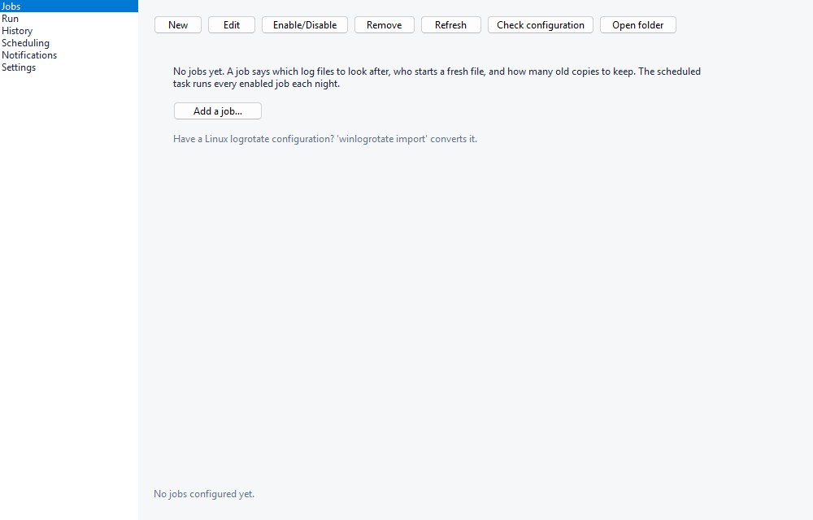

2. **Files**: type a **Name**, then pick a log with **Browse…** or type its path in **Which files**,
   one pattern per line. `*` stands for anything in a name, `**` also searches subfolders. The line
   under the box says how many files the pattern matches.

   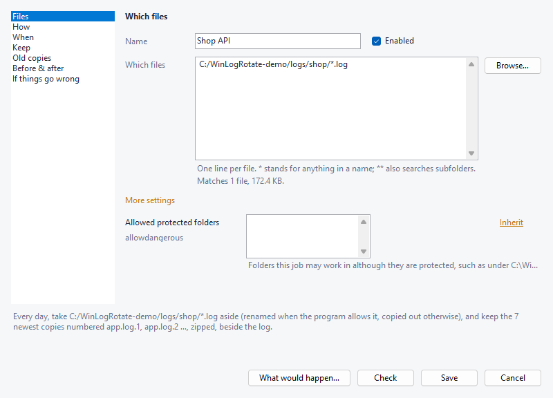

3. **How**: say how the program treats its log.
   - **Let WinLogRotate check what the program allows (recommended)**: renamed when the program
     allows it, otherwise copied out and emptied in place.
   - **The program keeps the log open and never starts a new file**: copied out and emptied in place.
   - **The program closes the log between writes, or reopens it after it moves**: renamed, and a
     fresh empty file created.
   - **The program already writes new files itself (IIS does); only tidy up**: see
     [the next section](#tidying-iis-logs-and-other-self-rolling-logs).
   - **Copy the log and leave it as it is (it keeps growing)**: a snapshot only.
4. **When**: **How often**, and optionally **or earlier once it exceeds** a size.
5. **Keep**: how many old copies, and **delete any older than** so many days.

   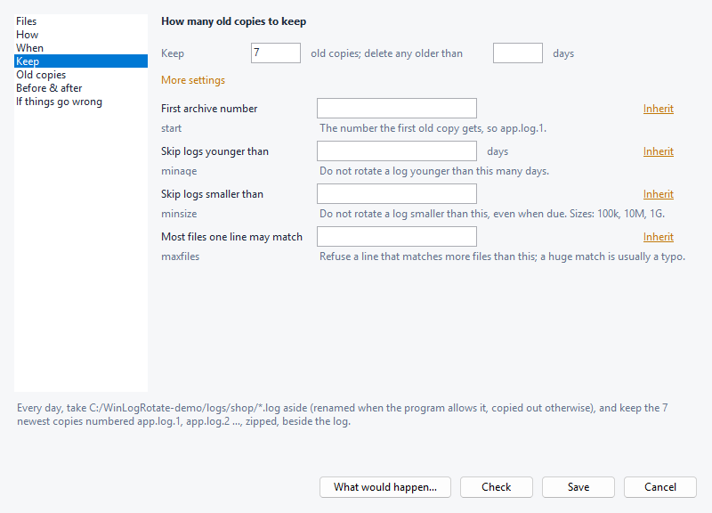

6. **Old copies**: **Numbered** or **Dated** names, the compression (**zip (opens in Explorer)**,
   **gzip (what log tools expect)** or **not compressed**), and **Put them in** a folder other than
   **beside the log**.
7. **Check** tries the job out and writes nothing. **Save** writes it; Windows asks for permission
   once.
8. Reopen the job and press **What would happen…** to see the moves it would make if it were due
   tonight. Nothing is changed.

**Before & after** holds the hooks ([hooks](hooks.md)) and **If things go wrong** what counts as an
error. Every setting a section does not ask about sits under **More settings**, captioned in plain
words with its key name, its default, and whether it is *set here* or *inherited*. A field shown as
inherited stays inherited unless you type in it; **Inherit** puts a set field back. The sentence
under the form restates the whole job.

Afterwards, on **Jobs**: **Edit** (or double-click) changes a job, **Enable/Disable** switches it
off and back on, **Remove** deletes its file after a confirmation, **Check configuration** validates
every job file with file, line and column, and **Open folder** opens the configuration folder.

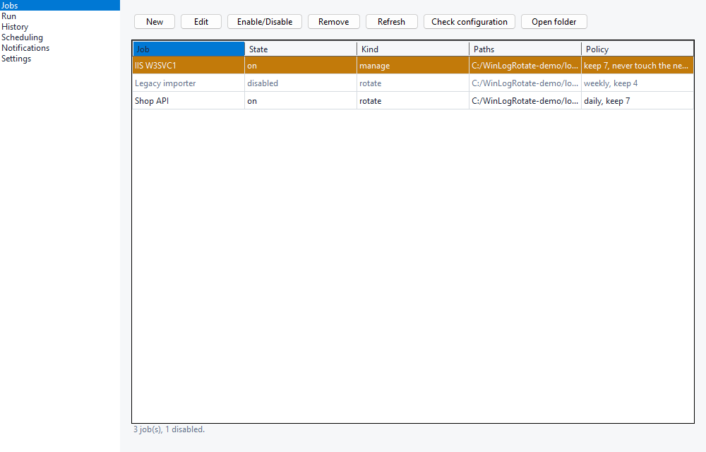

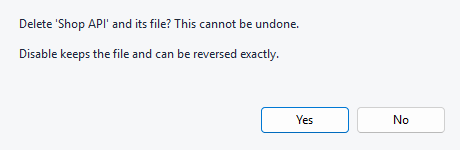

### From the prompt, or as a file

From an elevated prompt:

```
winlogrotate job add myapp --paths "D:/apps/myapp/logs/*.log" --set rotate=14 --set lockstrategy=auto --dry-run
winlogrotate job add myapp --paths "D:/apps/myapp/logs/*.log" --set rotate=14 --set lockstrategy=auto
winlogrotate job set myapp --set maxage=60       # one key, nothing else in the file changes
winlogrotate job show myapp
winlogrotate job disable myapp                   # reversible; 'job remove' is not
```

`--dry-run` shows what would be written and what a run would make of it. Repeat `--paths` for more
than one pattern; `--unset KEY` makes the job inherit that key from `[defaults]` again. A job file
written by hand in `conf.d\` works the same way: [the shortest job that works](configuration.md#the-shortest-job-that-works)
and [every key](configuration.md#every-job-key). `winlogrotate config check` validates it.

Defaults for every job live in `[defaults]` in `config.toml`; the installer seeds daily, keep 7,
zip. Coming from Linux: `winlogrotate import \\srv\etc\logrotate.d\nginx` converts a logrotate file
into `conf.d\`, creates the job disabled, and writes what it could not translate as TODO comments
([importing](logrotate-compatibility.md#importing-an-existing-config)).

## Tidying IIS logs and other self-rolling logs

IIS, http.sys, NSSM, WinSW, Serilog, NLog, log4net and Tomcat start a new file themselves and never
delete the old ones. For them, use a **manage** job: it never touches the newest file, and
compresses and deletes the older ones.

1. Find them: `winlogrotate scan` lists producers on this machine and whether each deletes its old
   files.
2. Create one job per log folder, in the console with **How** → **The program already writes new
   files itself (IIS does); only tidy up**, or:

   ```
   winlogrotate job add "IIS W3SVC1" --kind manage --paths "C:/inetpub/logs/LogFiles/W3SVC1/u_ex*.log" --set rotate=30 --set maxage=90
   ```

3. A pattern may span folders (`C:/inetpub/logs/LogFiles/W3SVC[0-9]/u_ex*.log`); each folder is
   then counted on its own, its newest file left alone and `rotate` kept per folder.
4. Test it: [Testing before anything changes](#testing-before-anything-changes).

`livefiles` (under **More settings** on **How**) leaves more than the newest file alone for a
producer that writes several at once. A manage job also counts the `.zip`/`.gz` it made itself.

## Logs another program holds open

Renaming a file Windows-side needs every open handle to allow it. Ask before you choose:

```
winlogrotate probe C:\logs\app.log
```

The verdict says which strategies this file allows right now: `rename`, `copytruncate`, `copy`, or
none (log4net's default `ExclusiveLock` allows none, so nothing outside the process can rotate it).
Then set **How** accordingly, or `lockstrategy` in the file:

| The program… | **How** | `lockstrategy` |
| --- | --- | --- |
| lets WinLogRotate decide each run | **Let WinLogRotate check what the program allows (recommended)** | `auto` |
| keeps the log open and never reopens it | **The program keeps the log open and never starts a new file** | `copytruncate` |
| closes or reopens its log | **The program closes the log between writes, or reopens it after it moves** | `rename` (the built-in default) |
| must never lose a line | **Copy the log and leave it as it is (it keeps growing)** | `copy` |

A program that needs telling to reopen its log gets a `postrotate` hook, such as
`service:paramchange:MyAppSvc` ([hooks](hooks.md); per-machine installs only). `copytruncate` on a
writer that caches its file offset fills the file with NUL bytes; WinLogRotate detects that and
refuses `copytruncate` for that path from then on
([locked files](logrotate-compatibility.md#locked-files)).

## Testing before anything changes

A dry run is the real run stopped one step before it acts.

- One job, in the editor: **What would happen…** (as if the job were due tonight).
- Every enabled job: **Run** → **Dry run**. It lists every deletion, compression and rename that
  **Rotate now** would make, and ends with `Nothing was changed.`

  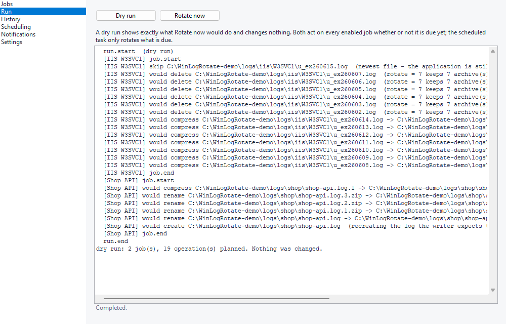

- From the prompt: `winlogrotate run --dry-run --force` for every job, add `--job NAME` for one and
  `--verbose` to see what is skipped and why. Without `--force` it shows what tonight's scheduled
  run would do.

**Run** → **Rotate now** then really rotates every enabled job, due or not (like `logrotate -f`),
after a confirmation and an administrator prompt. The scheduled task only rotates what is due, and a
log it sees for the first time is only given a clock; it rotates one interval later.

## Scheduling

The installer registers the daily task (`\WinLogRotate\Rotate`, as SYSTEM, at 03:00). To change it:

1. **Scheduling**: the first line says what is registered now.
2. Choose **Scheduled task (recommended)** and set **Runs daily at**, or **Neither - I will trigger
   it myself**.
3. **Apply**.

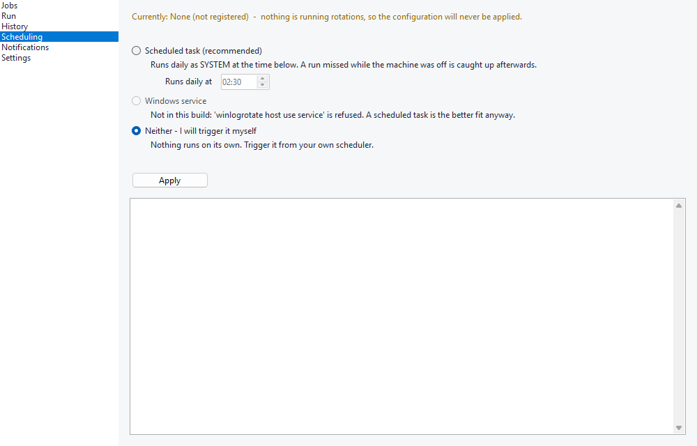

From the prompt: `winlogrotate host use task --at 22:30` or `winlogrotate host use none`. The time is
stored in `[host]` in `config.toml` ([`[host]`](configuration.md#host-when-the-scheduled-task-fires)),
so it survives repairs and upgrades. A run missed while the machine was off runs when it is back.

For a maintenance window, `winlogrotate host pause --for 2h` suspends rotations without unregistering
anything (`30m`, `2h`, `7d`, at most a year); `winlogrotate host pause` with no duration resumes.
`winlogrotate host status` compares what is configured with what is registered, and
`winlogrotate host repair` puts the task and the folder permissions back.

## Rolling out to many machines

1. **Prepare a share** with the job files (`*.toml`) you tested on one machine, for example
   `\\srv\deploy\jobs`.
2. **Install silently**, from an elevated context (a silent per-machine install without
   administrator rights exits `3` and installs nothing):

   ```
   WinLogRotate-Setup-<version>.exe /S /AllUsers /HOST=task /CONFIG=\\srv\deploy\jobs
   ```

   `/CONFIG=` copies every `*.toml` into `conf.d` before the folder is locked down. It does not
   seed `config.toml`.
3. **Set the time** if 03:00 is not right: `winlogrotate host use task --at 22:30`.
4. **Store credentials** on each machine. The encrypted store is bound to the machine and cannot be
   copied, so each machine imports its own, from an elevated prompt:

   ```
   winlogrotate secret import --from-file \\srv\deploy\secrets.txt
   ```

   The file holds `name=value` lines (`#` comments and blank lines are skipped); the configuration
   refers to each as `@secret:name`. Any bad line refuses the whole file and stores nothing.
   Without `--from-file` the lines are read from standard input, which leaves no plaintext file to
   clean up; `winlogrotate secret list` shows names and dates, never values.
5. **Check** each machine: `winlogrotate doctor --json`, and `winlogrotate notify test` once
   alerts are configured.

When Group Policy or DSC must own the scheduled task, `winlogrotate host export-task > task.xml`
prints the exact task this machine would register (its executable path, configuration folder and
time), for import there. The installer unregisters `\WinLogRotate\Rotate` on every install, upgrade
and uninstall, so a policy-owned task under that path is back after the next policy refresh.

Every installer switch:

| Switch | |
| --- | --- |
| `/S` | Silent. Every prompt takes its safe default: an upgrade waits for a running rotation, an uninstall keeps your data |
| `/AllUsers` / `/CurrentUser` | Per-machine (`ProgramData`, SYSTEM task, locked-down directory) or per-user (your profile, hooks refused). Without either, an upgrade keeps the existing scope and a new install is per-machine |
| `/HOST=task` / `/HOST=none` | Register the scheduled task, or nothing. Without it, an upgrade keeps the existing choice. Anything else exits `2` before anything is installed |
| `/CONFIG=<dir>` | Copy every `*.toml` from that directory into `conf.d` |
| `/NOPATH` | Leave PATH alone |
| `/NORUNTIME` | `-min` only: do not install the .NET Desktop Runtime the console needs; the CLI works without it |
| `/FORCEIDLE` | After two minutes of waiting for a rotation in progress, go ahead anyway. Off by default because the process being replaced may be mid-file on a multi-gigabyte log |
| `/RESTART` | With `/S`, start the console again once the files are in place, as the desktop user rather than elevated. What an in-app update passes |
| `/D=<dir>` | Install directory (the standard NSIS switch; must be last) |
| exit code `2` / `3` | `/HOST=` named no run model this build has / a silent all-users run without administrator rights. Nothing was installed either way |

Scripts that drive the CLI read `--json`: one envelope, a stable `LRxxxx` code on every finding, and
five exit codes ([automation](automation.md)).

## Alerts when rotation fails

Nothing reports a failure until `[notify]` names a target. The simplest needs no credential and no
network; the seeded `config.toml` carries it commented out:

```toml
[notify]
to = ["eventlog:"]
```

Failures then reach the Application log as event 155 (per-machine installs only). For email,
webhooks or Pushover, add a provider as in [notifications](notifications.md#targets), then:

1. Store its credential: **Notifications** → select the provider row → **Set credential...** → type
   it twice → **Store**. From the prompt: `winlogrotate notify set-secret email.ops password`. Either
   way the value goes to the encrypted store and the configuration is pointed at it.

   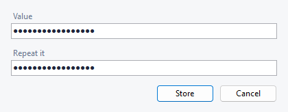

2. **Send test** (`winlogrotate notify test`) sends a real message to every channel and records
   nothing.

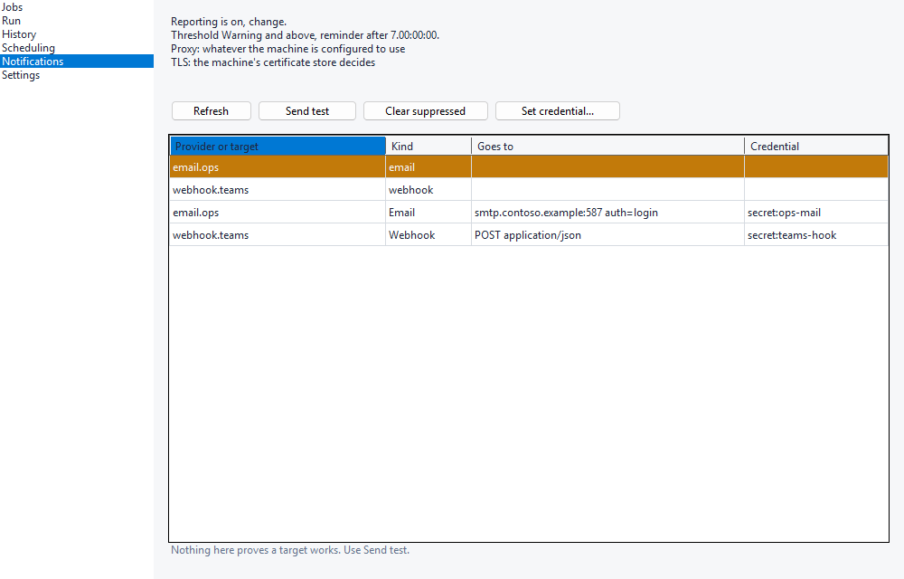

A run reports once, only when a job's outcome changes, with a reminder after 7 days of continuing
failure; the first run after installing says nothing. A channel that keeps failing is suppressed:
**Clear suppressed** (`winlogrotate notify reset`) reopens it once it is fixed.
`winlogrotate notify status` shows what was last decided. Details: [notifications](notifications.md).

## Reading status and diagnosing failures

**What happened to a file**: **History**, or `winlogrotate journal` (`--job NAME`, `--since TIME`).
Every compression, move and deletion, when, by which job, and why, failures included.

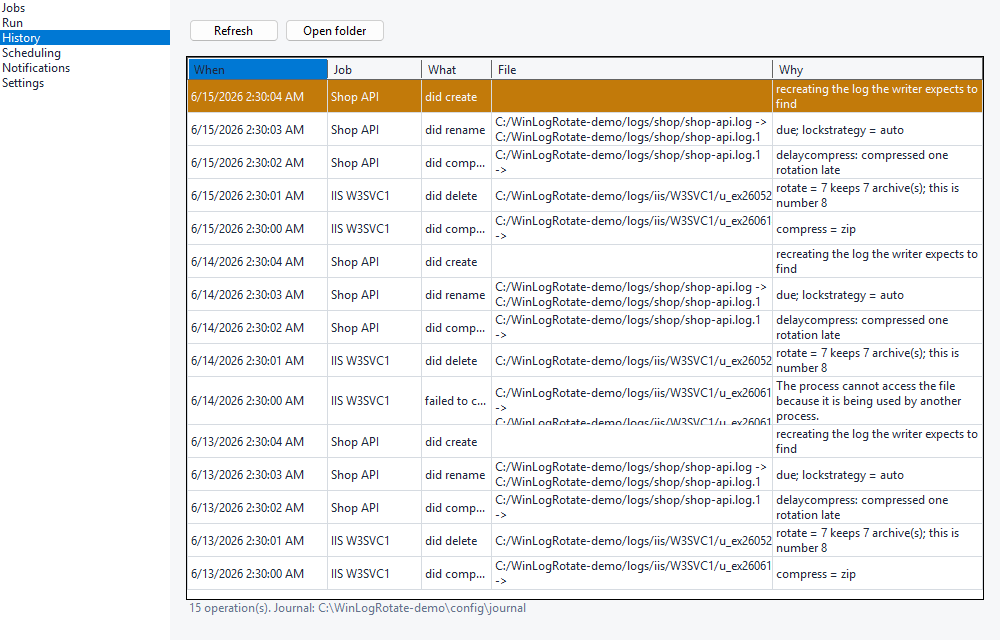

**Whether everything is set up**: **Settings** shows the `winlogrotate doctor` report: paths,
whether the configuration folder is hardened and hooks permitted, elevation, the run host and its
time, and notification state. **Repair permissions** (`winlogrotate host repair --acl`) re-locks the
configuration folder.

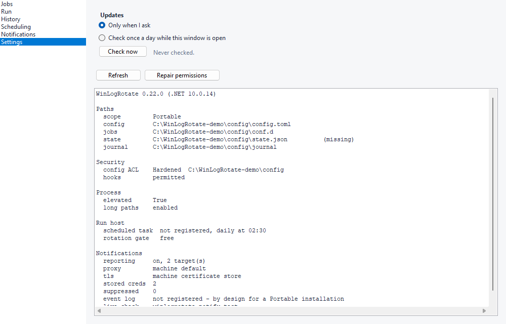

**Whether the configuration is valid**: **Jobs** → **Check configuration**, or
`winlogrotate config check`. A job with a mistake is skipped and named while every other job
rotates; the check says which file, which line and why.

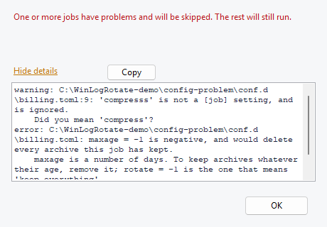

**What went wrong overnight**: warnings and errors go to the Application log under the source
`WinLogRotate` ([event IDs and queries](diagnostics.md#reading-them)). Task Scheduler's Last Run
Result proves nothing ([why](diagnostics.md#why-not-lasttaskresult)). Exit codes: `0` done, `1`
something in the work failed, `2` nothing attempted (bad configuration or command line), `3` another
run held the lock, `4` a defect in WinLogRotate ([details](automation.md#exit-codes)).

Common causes:

| Symptom | Where to look |
| --- | --- |
| A job never rotates | `run --dry-run --verbose --job NAME` says why (not due yet, `notifempty`, `minsize`, first sighting) |
| "being used by another process" in **History** | [Logs another program holds open](#logs-another-program-holds-open) |
| Hooks refused | Per-user install, or a configuration folder others can write: `doctor`, then **Repair permissions** |
| No alerts | `notify show`, `notify status`, `notify test` |
| Nothing runs at night | **Scheduling** / `host status` |

## Updating

**Settings** → **Updates**: **Check now**, then **Update…** once a newer release is found. The
download is checked against the release's checksums, the installer waits for a running rotation,
keeps the configuration, and the console comes back at the new version. **Check once a day while
this window is open** checks automatically; installing is always a press.

From the prompt: `winlogrotate update check`, `winlogrotate update apply`. Silent, by hand:
`WinLogRotate-Setup-<version>.exe /S` keeps the existing scope and run host. A portable copy is
replaced by unzipping the new release over it. Policy, proxies, and what each refusal means:
[updating](updating.md).

## Uninstalling

1. Windows **Settings** → **Apps** (or **Programs and Features**) → **WinLogRotate** →
   **Uninstall**, or `uninstall.exe` in the install folder. Removing a per-machine install needs administrator rights.
2. It asks whether to remove the configuration, rotation history and job files. **No** keeps them for
   a future install.

The uninstaller removes the scheduled task and the PATH entry. Silent:

```
"C:\Program Files\WinLogRotate\uninstall.exe" /S              # keeps configuration, history and stored secrets
"C:\Program Files\WinLogRotate\uninstall.exe" /S /PURGEDATA   # removes them too
```

Use `/PURGEDATA` when you retire a machine: without it the encrypted credential store stays on disk.
