# Screenshots

Every page and dialog of the console (`winlogrotate-gui.exe`), on a fictional web server with three
jobs. Made by the docs tour (`tests/WinLogRotate.Gui.Tests`), never by hand — the README's
[Screenshots](../../README.md#screenshots) section says how to regenerate them. Everything the
console does, it does by running `winlogrotate.exe`, so each page has a CLI equivalent.

## Jobs

Every job on the machine: whether it is on, what kind it is, which files it takes and its policy in
plain words. New, Edit, Enable/Disable and Remove change job files; Check configuration validates
them (`winlogrotate config check`).

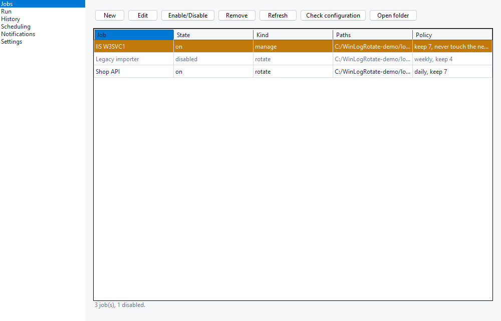

## Jobs, before the first one

With no jobs, the page says what a job is and offers to add one.

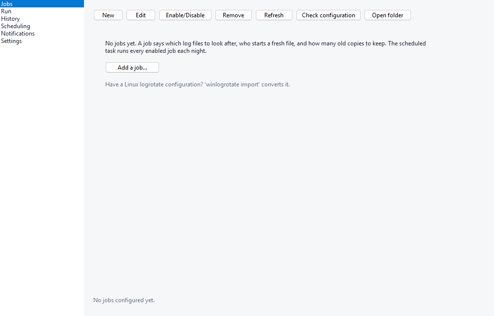

## Check configuration

A job file with mistakes is skipped and named while the rest of the machine rotates. Check
configuration says which file, which line and why — here a misspelled key and a negative `maxage`.

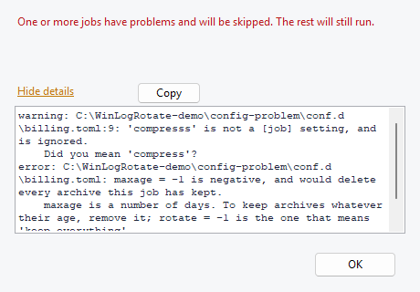

## Job editor

A menu of sections — Files, How, When, Keep, Old copies, Before & after, If things go wrong — each
with its plain choices first and every other setting under **More settings**. The sentence at the
bottom restates what the job will do; **What would happen…** shows a dry run of it.

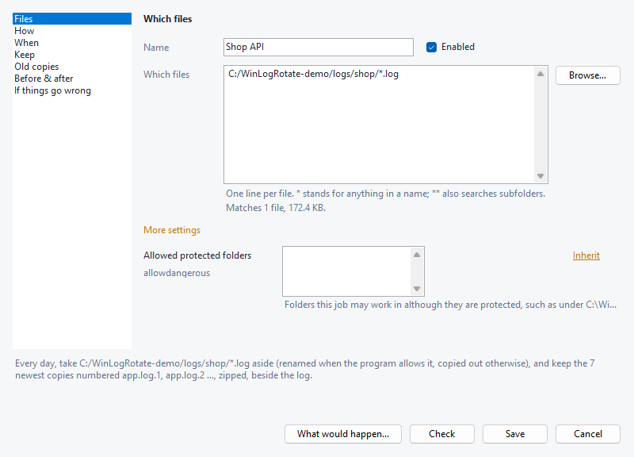

## Job editor: Keep

How many old copies to keep and for how long. An empty field under More settings inherits its
value from `[defaults]` or the built-in default, and stays inherited unless you type in it.

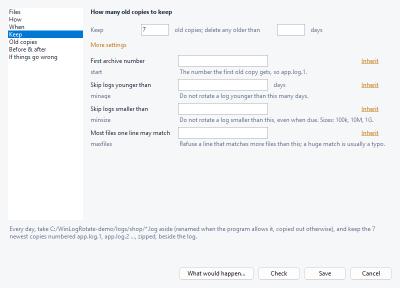

## Remove a job

Removing deletes the job's file, so it asks first and points at Disable, which can be undone.

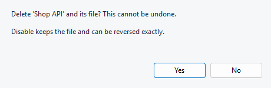

## Run

**Dry run** shows exactly what **Rotate now** would do and changes nothing; both act on every
enabled job whether or not it is due, like `logrotate -f`.

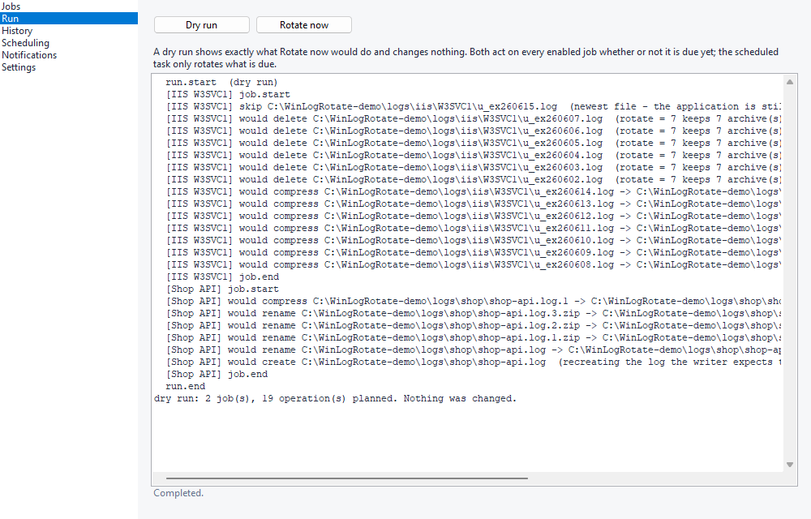

## History

The journal: every file compressed, moved or deleted, when, by which job, and why — one line per
operation, failures included (`winlogrotate journal`).

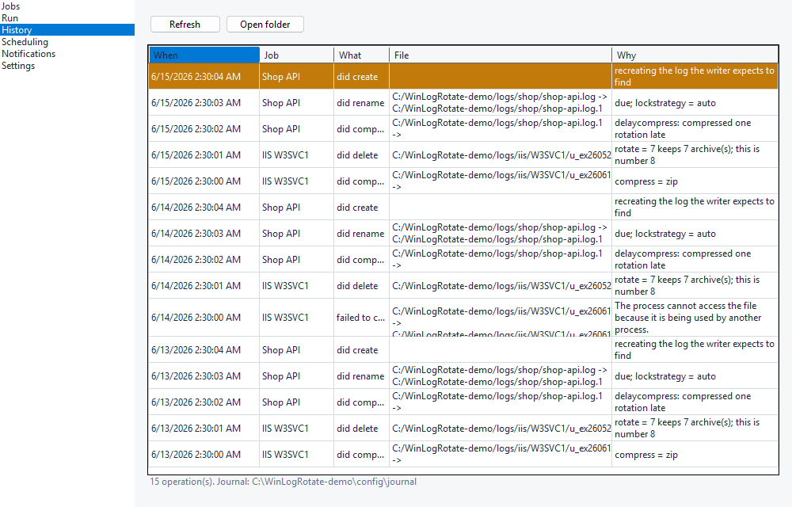

## Scheduling

What runs rotations: the scheduled task (daily, as SYSTEM, at the time shown) or nothing. This
machine has no task registered yet, which the page says in so many words.

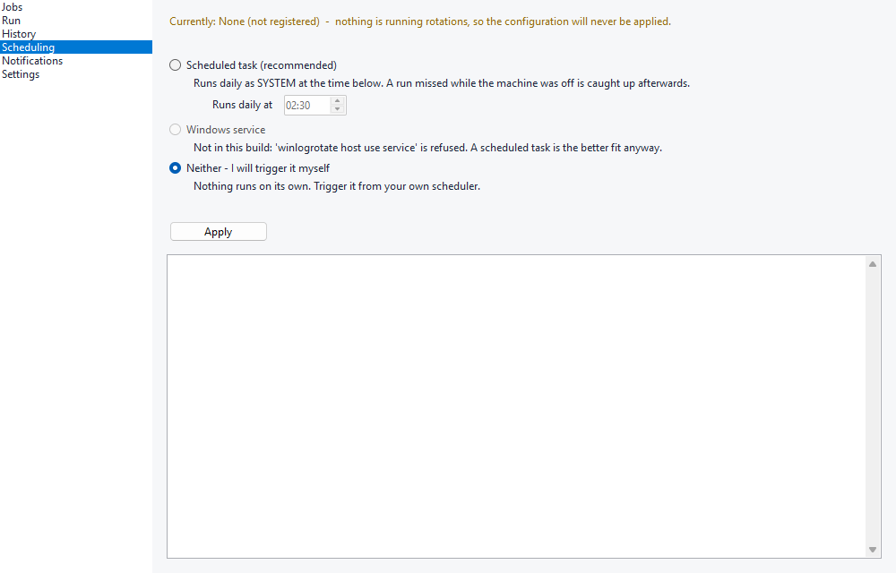

## Notifications

Where failures are reported: targets above, providers below with where they send and which stored
credential they use. Send test proves a channel works (`winlogrotate notify test`).

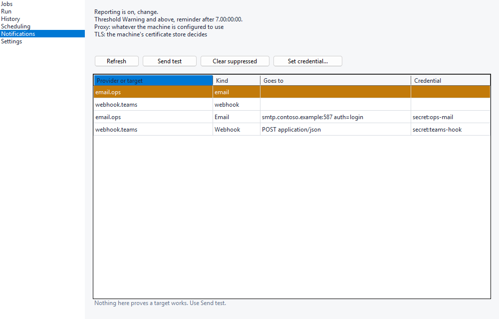

## Set credential

Stores the selected provider's password or token in the encrypted store; the value goes to the
elevated CLI over a private pipe, never on a command line.

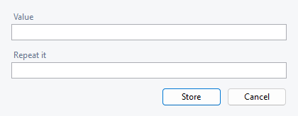

## Settings

Updates (manual unless you ask for a daily check) and the `winlogrotate doctor` report: paths,
permissions, run host and notification state in one place.

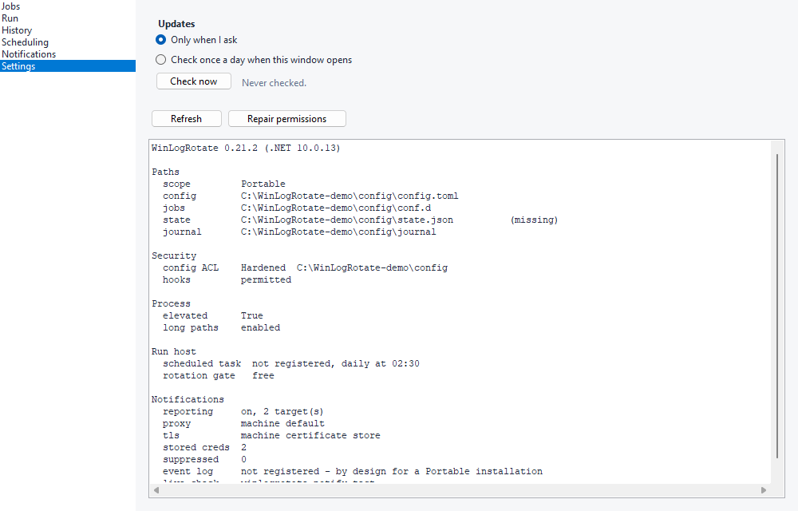
