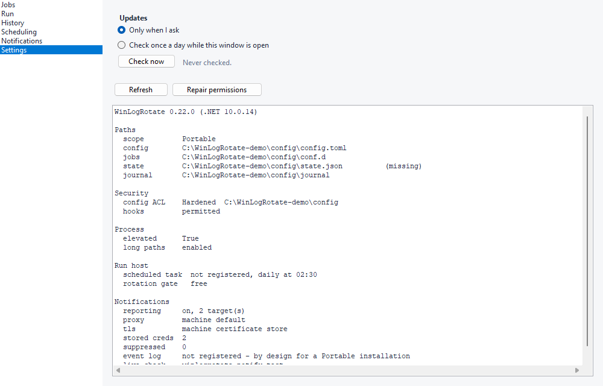

# Updating

WinLogRotate updates itself the way it was installed: by running the newer release's installer
over the old one. The installer keeps your configuration, waits for any rotation in progress to
finish before it replaces a file, closes the console if it is open, and can open it again
afterwards. Nothing about a rotation changes while an update runs, and no rotation is ever
interrupted by one.

There are three ways to get there, and they all do the same thing.

## By hand

Download the installer from the [latest release](../../../releases/latest) and run it. It finds
the existing install, keeps its scope (all users or just you) and its run host (the scheduled
task, or none), and upgrades in place. Silent: `WinLogRotate-Setup-<version>.exe /S`.

## From the prompt

```
winlogrotate update check
winlogrotate update apply
```

`update check` asks GitHub which release is newest and says whether it is newer than this one.
It makes no changes and needs no rights. Under `--json` it also reports `scope` (`PerMachine`,
`PerUser` or `Portable`) and `variant` (`full` or `min`), and when a newer release exists, its
page as `detail`. A development build (version `0.0.0`, anything not built by the release
workflow) is told the newest release with `detail: "development build"` and is never offered it.

`update apply` does the update:

1. Reads what the installer recorded: for whom this copy was installed, which run host it was set
   up with, and which GUI build it carries. An entry counts only if its install folder is the
   folder this `winlogrotate.exe` runs from (the per-user entry first, then the all-users one), so
   an unzipped copy on a machine that also has an installed one is still a portable copy.
2. Fetches the release's `SHA256SUMS.txt`, then the matching installer (`-full` for a
   self-contained GUI, `-min` for one that uses the .NET Desktop Runtime), into a folder under
   `%TEMP%`. Progress is printed, and streamed as events under `--json-stream`.
3. Compares the download's SHA-256 with the release's. A mismatch deletes the download and stops
   with `LR4006`; nothing is run.
4. Starts the installer silently with every switch this install was made with, and exits. The
   installer then waits for any rotation in progress, closes the console, replaces the files, and
   with `--restart-gui` starts the console again.

What it needs: an installed copy, not a portable one (a portable copy is refused with a sentence
saying to unzip the new release over it). It does not need an elevated prompt. For an all-users
install run from an ordinary prompt, the download happens with your own rights and only the
installer is started through the administrator prompt (UAC); from an elevated prompt there is no
prompt at all. A per-user install never prompts: the installer runs with your own rights.
Answering No to the prompt changes nothing - the download is deleted - and is reported as
`detail: "declined"` with `LR4006`. Exit 0 means the installer was handed the file; whether the
install then finished is what `winlogrotate --version` says a minute later.

A script can rely on the exit code: 0 when up to date, on a development build, or handed over;
1 with `LR4006` when a newer release exists and was not installed, including when the
administrator prompt was declined; and the usual envelope either way. `update apply`
from a scheduled task is not something this product does on its own; if you want unattended
updates, that is one line of configuration management calling this verb.

## From the console

Settings, at the top: **Updates**.



- **Only when I ask** is the default. Nothing reaches the internet unless you press Check now.
- **Check once a day while this window is open** runs the same check, at most once a day: when
  the console starts, and then every hour for as long as it stays open, checking only once a day
  has passed since the last check. It only checks. A newer release shows as a line across the top
  of the window; installing is always a press.
- **Check now** asks, and the line beside it says what came back: the newer version, that this is
  the newest, that the feed could not be reached, or that policy forbids checking.
- **Update…** appears once a check has found a newer release. It runs `update apply` for you,
  never elevated itself. On an all-users install the button carries the shield: once the download
  is verified, the installer asks for administrator rights, and only the installer gets them.
  Answering No says "The administrator prompt was declined. Nothing was changed." and leaves the
  button there to try again. A per-user install asks nothing. The download shows on the same
  line, and then the window closes and opens again at the new version.
- **Open download page** appears instead of Update on a portable copy, which has no installer to
  re-run: it opens the release page in the browser, to download the new release and replace this
  copy by hand (or to run its installer, after which updates are handled here).

If the window does not come back within a few minutes, the update did not install: a rotation
that ran for over two minutes makes the installer give up rather than interrupt it, and the panel
says so. Press Update again when the rotation has finished.

The choice and the time of the last check are stored per user, in
`%LOCALAPPDATA%\WinLogRotate\gui.json`. Nothing else is. A check that policy forbade is not
recorded as a check, so the first one after the policy is lifted is not held back a day.

Each update downloads into its own `%TEMP%\WinLogRotate-update-…` folder. The installer cannot
delete itself, so those folders are removed once they are a day old, when the console starts and
before each new download.

## What is verified, and what is not

Every download is checked against the release's `SHA256SUMS.txt` before it is run. That catches a
download that was cut short, a file that was corrupted on the way, and a file on the download host
that is not the one the release lists.

It does not catch a compromised repository account, because the checksum file lives in the same
release as the installer. Nothing is code-signed yet; when a certificate exists, a signature check
is added at the same point, and this section will say so.

The only redirect followed is GitHub's own, to its file store. A feed that answers with anywhere
else is not followed.

## Policy

To stop every update check on a machine, including the console's:

```
HKLM\SOFTWARE\Policies\WinLogRotate
    DisableUpdateCheck  REG_DWORD  1
```

Both verbs then report "disabled by policy" at exit 0, and the console says so on the panel.

## Proxies

The update verbs reach GitHub through the proxy Windows itself is configured with, exactly as a
browser on the same account would. The `proxy` setting under `[notify]` governs notifications and
is not consulted here.

## When it refuses

`LR4006` (event 145) means a newer release exists and was not installed, and the message says
which step stopped: the checksum file could not be downloaded, could not be read, or does not
list the installer; the installer could not be downloaded; the download did not match; the
installer could not be started; the administrator prompt was declined (`detail: "declined"`).
Nothing was changed in any of those cases, and the download, if there was one, was deleted.

`LR4004` (event 143) means the feed could not be reached, which is a warning at exit 0: the
machine may be offline, and that is not a rotation problem.

A portable copy is refused with `LR1005`: unzip the newest release over it yourself, or run the
installer once to have updates handled from then on.
